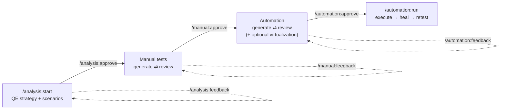

# QEAgent

A human-gated quality engineering agent for **[Gemini CLI](https://github.com/google-gemini/gemini-cli)**. QEAgent reads a project's design documents and produces:

- a risk-based QE strategy;
- design-derived test scenarios;
- manual test cases a newcomer can follow;
- synthetic test data;
- Playwright TypeScript UI and API automation.

Every phase stops for your review and explicit approval before the next one starts.

## What makes it different

- **Design is the only source of expected behavior.** Requirements and user stories define scope and reveal gaps; they never add behavior the design doesn't describe. OpenAPI specs and Postman collections count as design when saved in `design/api/`.
- **Approval gates are checked by code, not just instructions.** Approve commands run a Node validator. It confirms the required artifacts and the saved reviewer report exist, that earlier phases are still approved and unchanged, and that the SHA-256 fingerprint of what you reviewed still matches.
- **Nothing is invented.** No made-up selectors, endpoints, credentials, test results, or traceability links. Generated data is synthetic and labeled as such.
- **Real bugs stay visible.** When a test fails, script problems go to a healing step and a targeted retest (two cycles at most). Genuine application bugs are reported, never "fixed" by weakening the test.

## How it works



| Phase | What QEAgent does | What you review | You decide with |
|---|---|---|---|
| 1. Analysis | QE-Architect writes `strategy/QE-strategy.md` and `strategy/test-scenarios.json`, and updates the traceability workbook | Strategy, scenarios, gaps, open questions | `/analysis:approve` or `/analysis:feedback` |
| 2. Manual tests | Generates step-by-step cases (each step has Test Description, Expected Result, Actual Result) plus manual data; a reviewer iterates until ready | Cases and `reviews/manual-test-review.md` | `/manual:approve` or `/manual:feedback` |
| 3. Automation | Generates Playwright UI/API tests for approved candidates plus automation data. Offers service virtualization only if the strategy recommends it and creates it only if you agree. A reviewer iterates until ready. | Code and `reviews/automation-test-review.md` | `/automation:approve` or `/automation:feedback` |
| 4. Execution | Only when you ask: runs the approved scope, classifies failures, heals script problems, retests | `run-summary.json` with initial and retest results | Nothing; running tests never approves anything |

Feedback on a phase reopens it and resets every later phase that depended on it.

## Requirements

- [Gemini CLI](https://github.com/google-gemini/gemini-cli), installed with `npm install -g @google/gemini-cli` (see its README for authentication).
- Node.js, at whatever version your Gemini CLI install requires. QEAgent's helpers use only Node's built-in modules; there is no `npm install` step for QEAgent itself. The helpers were tested on Node 24.
- For Playwright execution: the target project's own Playwright and TypeScript setup.
- Optional: a spreadsheet capability (for example a vetted MCP server or local script) so QEAgent can edit the `.xlsx` traceability workbook. Gemini CLI has no built-in spreadsheet tool, so without one, workbook updates are reported as blocked.

## Get started

```bash
git clone https://github.com/earlhanz/QEAgent.git
cd QEAgent
gemini
```

Always start Gemini CLI from the repository root: the hooks and commands use paths relative to it. If you have enabled Gemini's [trusted folders](https://github.com/google-gemini/gemini-cli/blob/main/docs/cli/trusted-folders.md) feature, trust this folder. An untrusted folder skips the project's `.gemini/settings.json` (where the hooks are configured) and its custom commands.

1. **Check the setup (recommended first time).** Paste the contents of [`GEMINI-ADOPTION-PROMPT.md`](GEMINI-ADOPTION-PROMPT.md) below its divider line. Gemini loads the workflow and checks that the commands, skills, subagent, hooks, and helpers work. It changes nothing.
2. **Create a project:** `/qe:create billingportal`
3. **Add sources:**
   - design documents (required) → `docs/billingportal/design/`
   - OpenAPI specs or Postman collections → `docs/billingportal/design/api/`
   - stories → `user-story/`; requirements → `requirements/`

   Don't add Postman environment files: they usually contain secrets.
4. **Analyze:** `/qe:start billingportal`, then `/analysis:start billingportal`. Review, then approve or give feedback.
5. **Continue** through manual tests and automation, one approved phase at a time.
6. **Run tests** when you're ready: `/automation:run billingportal`.

Use a short folder-style name (letters, numbers, `_`, `-`) without angle brackets.

## Commands

| Command | Purpose |
|---|---|
| `/qe:create <project>` | Create `docs/<project>/` and `output/<project>/`, the state file, and a traceability workbook from the template. Never overwrites. |
| `/qe:start <project>` | Select a project and load only its context. Prunes finished checkpoint tasks. |
| `/qe:checkpoint <project>` | Save a small restart snapshot (at most 5 active tasks and 5 next actions). |
| `/qe:continue <project>` | Resume after a break, a restart, or context compression. |
| `/analysis:start <project>` | Create the strategy and scenarios, then stop for review. |
| `/analysis:feedback <project> <comment>` | Revise analysis (resets later phases). |
| `/analysis:approve <project>` | Validate and approve analysis. |
| `/manual:feedback <project> <comment>` | Revise manual tests. |
| `/manual:approve <project>` | Validate and approve manual tests. |
| `/automation:feedback <project> <comment>` | Revise automation. |
| `/automation:approve <project>` | Validate and approve automation. |
| `/automation:run <project> [spec or tag]` | Execute approved tests with heal-and-retest for script failures. |
| `/automation:heal <project> [spec]` | Diagnose and minimally fix one failing Playwright test. |

## Where files go

| Path | Contents |
|---|---|
| `docs/<project>/design/` (and `design/api/`) | Your design sources: the authority for expected behavior |
| `docs/<project>/user-story/`, `requirements/` | Scope, constraints, data contracts |
| `docs/<project>/strategy/` | `QE-strategy.md`, `test-scenarios.json` |
| `docs/<project>/reviews/` | Saved reviewer reports (gate evidence) |
| `docs/<project>/qe-state.json` | Progress index, changed only through helpers; not evidence |
| `docs/<project>/traceability-matrix.xlsx` | Design → requirement → scenario → manual → automation → data links |
| `output/<project>/manualtests/` | Manual test cases |
| `output/<project>/testdata/manual/`, `testdata/automation/` | Synthetic datasets and generator manifests |
| `output/<project>/automated tests/` | Playwright project root (`src/pages`, `src/components`, `src/api`, `src/fixtures`, `tests`) |
| `output/<project>/automationservice/` | Optional, user-approved service virtualization |
| `output/<project>/.qe/runs/<run-id>/` | Run summary, raw log, healing handoffs, evidence (git-ignored) |

## Skills

| Skill | Use |
|---|---|
| `qe-architect` | Project-wide strategy, test levels, risks, design-derived scenarios, virtualization recommendation |
| `generate-manual-test` / `manual-test-reviewer` | Detailed manual cases, and an independent review with a saved report |
| `test-data-generator` | Reproducible synthetic data from sourced constraints |
| `generate-automation-test` / `automated-test-reviewer` | Playwright UI and API tests (fixtures-first POM, locator priority, no sleeps), and their review |
| `service-virtualizer` | Contract-grounded mocks or stubs, only after you agree |
| `automated-test-execution` (+ `playwright-test-executor` subagent) | Run, classify, and report |
| `heal-playwright-automation` | Triage first; minimal fixes; never mask application bugs |

## What is enforced vs. guided

| Enforced by code | Guidance only (followed by the model) |
|---|---|
| `qe-workflow.js`: gate prerequisites, fingerprints, upstream approvals, virtualization decision | Design-only expected behavior, test quality, review depth |
| Helpers: project-scoped paths, symlink rejection, size limits, no silent overwrites, checkpoint and run-summary formats | Asking before virtualization, compact handoffs |
| BeforeTool hook: blocks direct edits to `qe-state.json` and early writes to gated output folders (best-effort) | Scope discipline, not inventing data |

The hook can't see writes made outside Gemini or indirectly by scripts. The validator's fingerprints are what make an approval trustworthy. See [`docs/WORKFLOW.md`](docs/WORKFLOW.md#enforcement-boundary) for details.

## Repository layout

| Path | What it is |
|---|---|
| [`GEMINI.md`](GEMINI.md) | Agent role, principles, routing (Gemini loads this automatically) |
| `.gemini/` | `settings.json` (hooks), `commands/`, `skills/`, `agents/`, `hooks/`, `tools/` (validator and helpers) |
| [`docs/WORKFLOW.md`](docs/WORKFLOW.md) | Phase prerequisites, gate rules, enforcement boundary |
| [`docs/HOW-TO-User-Guide.docx`](docs/HOW-TO-User-Guide.docx) | Beginner guide (setup, phases, checkpoints, maintenance, glossary) |
| [`docs/review/CLAUDE-REVIEW.md`](docs/review/CLAUDE-REVIEW.md) | Latest review: findings, fixes, verification, open owner decisions |
| `docs/sampleprojectname/` | Template only: starter state and header-only workbook copied by `/qe:create` |
| [`STRUCTURE.md`](STRUCTURE.md) | Full folder map |
| `work/` | Earlier maintenance scripts and screenshots; not part of the agent |

Helper usage and limits: [`.gemini/skills/_shared/references/deterministic-tools.md`](.gemini/skills/_shared/references/deterministic-tools.md). `mcp/` and `extension/` are planned and not present.

## Known limitations

- Editing the traceability workbook needs a spreadsheet capability you provide.
- There is no post-compression hook in Gemini CLI. Use `/qe:continue <project>` after compression.
- The BeforeTool hook is best-effort and lets actions through if it fails to run (for example, when Gemini is started outside the repository root).
- `qe-api.js` reads JSON only (no YAML) and does not resolve OpenAPI `$ref`s.
- API-only scenarios still need an approved manual case before automation.

Open items and verification details are tracked in [`docs/review/CLAUDE-REVIEW.md`](docs/review/CLAUDE-REVIEW.md).

## Maintaining QEAgent

When you change a phase, update its command, skill, shared reference, `docs/WORKFLOW.md`, `GEMINI.md`, and the validator together. Recheck Gemini CLI's docs when upgrading, because hook, command, skill, and subagent formats can change: [configuration](https://github.com/google-gemini/gemini-cli/blob/main/docs/reference/configuration.md) · [hooks](https://github.com/google-gemini/gemini-cli/blob/main/docs/hooks/reference.md) · [custom commands](https://github.com/google-gemini/gemini-cli/blob/main/docs/cli/custom-commands.md) · [skills](https://github.com/google-gemini/gemini-cli/blob/main/docs/cli/creating-skills.md) · [subagents](https://github.com/google-gemini/gemini-cli/blob/main/docs/core/subagents.md).

## License

No license file is included yet, so default copyright applies. Add a `LICENSE` file before others reuse or contribute to this project.
